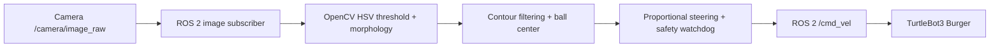

# TurtleBot3 Visual Ball Following — ROS 2 + OpenCV

A compact ROS 2 Python package for **camera-based orange-ball detection and reactive following** on a TurtleBot3 Burger. Uses HSV segmentation, geometric contour filtering and proportional steering; no neural network, LiDAR or SLAM is required for this particular task.

> **Project status:** reconstructed from an earlier TurtleBot3 ball-following experiment (ROS 2 Humble, Ubuntu 22.04). Pure vision unit tests are provided. This packaged version has **not** been retested on physical TurtleBot3 hardware, so no hardware performance or success rate is claimed. Replace/compare the reconstruction with the original implementation before describing it as a validated deployment.

## Overview



| Setting | Value |
|---|---|
| Robot | TurtleBot3 Burger |
| Target software | Ubuntu 22.04 / ROS 2 Humble |
| Input | `/camera/image_raw` (`sensor_msgs/msg/Image`) |
| Output | `/cmd_vel` (`geometry_msgs/msg/Twist`) |
| Detection | Orange HSV `[6,110,110]`–`[25,255,255]` |
| Filter | Largest valid contour, area >400 px², radius >15 px, circularity >0.6 |
| Steering | `angular.z = 0.004 * horizontal_pixel_error`, clipped to ±1.0 rad/s |
| Forward speed | Conservative **example** `0.08 m/s`, only when reasonably centered. Original forward-speed value not verified. |

## Repository layout

```text
ros2-visual-ball-follower/
├── ball_follower/
│   ├── ball_follower/
│   │   ├── image_subscriber.py    # ROS 2 node and safety logic
│   │   └── vision.py              # Pure OpenCV detection
│   ├── config/ball_follower.yaml
│   ├── launch/ball_follower.launch.py
│   ├── package.xml
│   ├── setup.cfg
│   ├── setup.py
│   └── resource/ball_follower
├── tests/test_vision.py           # Pure Python vision tests
├── docs/architecture.md
└── README.md
```

## Prerequisites

- ROS 2 **Humble** sourced on Ubuntu 22.04
- Python 3 with `numpy`, `cv2`, ROS packages `rclpy`, `cv_bridge`, `sensor_msgs`, `geometry_msgs`
- Camera node publishing `sensor_msgs/msg/Image` on `/camera/image_raw`
- TurtleBot3 bringup providing a `geometry_msgs/msg/Twist` consumer on `/cmd_vel` (confirm the actual message type)

Install the usual system packages if missing:

```bash
sudo apt update
sudo apt install -y ros-humble-cv-bridge python3-opencv python3-numpy python3-pytest python3-colcon-common-extensions
```

## Build in a clean workspace

Unpack or clone this repository beneath `~/ball_follow_ws/src/`, then:

```bash
source /opt/ros/humble/setup.bash
cd ~/ball_follow_ws
colcon build --symlink-install
source install/setup.bash
```

## Running

First verify the camera and the robot topic type (camera/robot must already be running in their respective terminals):

```bash
ros2 topic list -t | grep -E 'image_raw|cmd_vel'
ros2 topic hz /camera/image_raw
ros2 topic info -v /cmd_vel
```

**Safe default: this package does not command motion until you explicitly enable it.**

```bash
# Observe detection without issuing movement commands
ros2 launch ball_follower ball_follower.launch.py

# After checking robot topic types and placing it in a safe, clear area:
ros2 launch ball_follower ball_follower.launch.py enable_motion:=true
```

Parameters can be changed in `ball_follower/config/ball_follower.yaml`; launch overrides `enable_motion` explicitly.

### Safety

- Start with wheels lifted or the robot in a controlled test area; keep an emergency stop available.
- This is color-based reactive control, **not obstacle avoidance**. Avoid stairs, people, and other hazards.
- With motion enabled, the node commands zero velocity when a ball disappears or camera frames stop arriving.
- No automatic distance sensing is implemented. A visually detected ball can still be too close for safe forward movement.
- Verify camera topics, frame dimensions, and the `/cmd_vel` message type for your platform before testing.

## Algorithm

1. Convert each image from BGR to HSV.
2. Threshold for an orange ball and apply three erosion/dilation iterations.
3. Find contours; keep those satisfying area, radius and circularity constraints.
4. Use horizontal distance from image center as a proportional steering error.
5. Publish commands only when motion is enabled, detection is recent, and camera frames are fresh.

See [architecture notes](docs/architecture.md) for trade-offs and next steps.

## Tests

The detector is independent of ROS, so its synthetic-image tests can run on a workstation:

```bash
python3 -m pytest -q tests/test_vision.py
```


## Author

Pouyan Damghani — [LinkedIn](https://www.linkedin.com/in/pouyan-damghani-b18134325/) | [GitHub](https://github.com/Pouyan-D)
